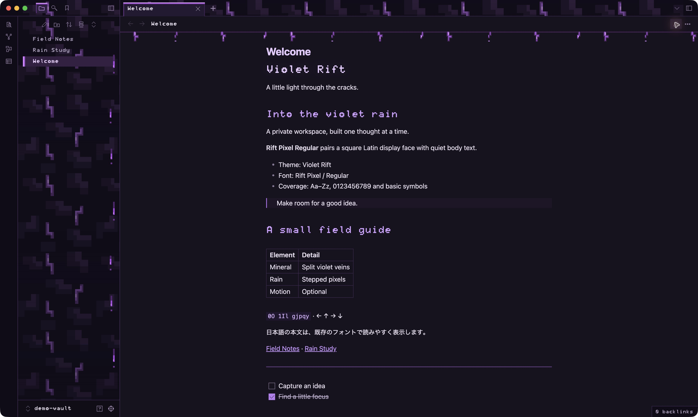

# Violet Rift by nu

A dark, pixel-art theme for Obsidian. Violet veins and falling sparks frame a square UI, with an optional display font and 88 matching icons.

**[Download the free preview ZIP](https://github.com/bruiselea/violet-rift/releases/download/0.2.0/Violet-Rift-0.2.0-preview.zip)** · [English installation guide](Guide/INSTALL-EN.md) · [日本語の導入ガイド](Guide/INSTALL-JA.md)

- **Violet Rift:** dark theme with square controls, pixel icons, and animated drips.
- **Rift Pixel Regular:** 112 characters covering English letters, digits, and selected symbols (TTF and WOFF). No Japanese glyphs; Japanese uses your existing font.
- **88 SVG icons:** included separately, with an offline gallery and optional CSS for display type, quieter visuals, or still drips.

Tested on macOS with Obsidian 1.14.4. Windows, Linux, and mobile have not been verified. This preview installs manually; see the linked guides.

Free for personal, non-commercial use under the [public preview license](LICENSE). Made with AI assistance and tested in Obsidian. An independent project by **nu**.
